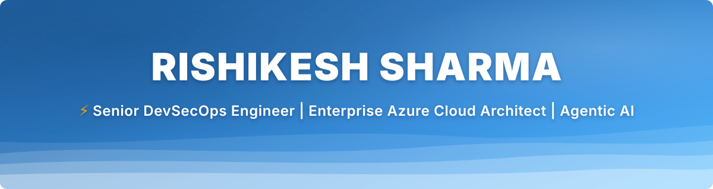
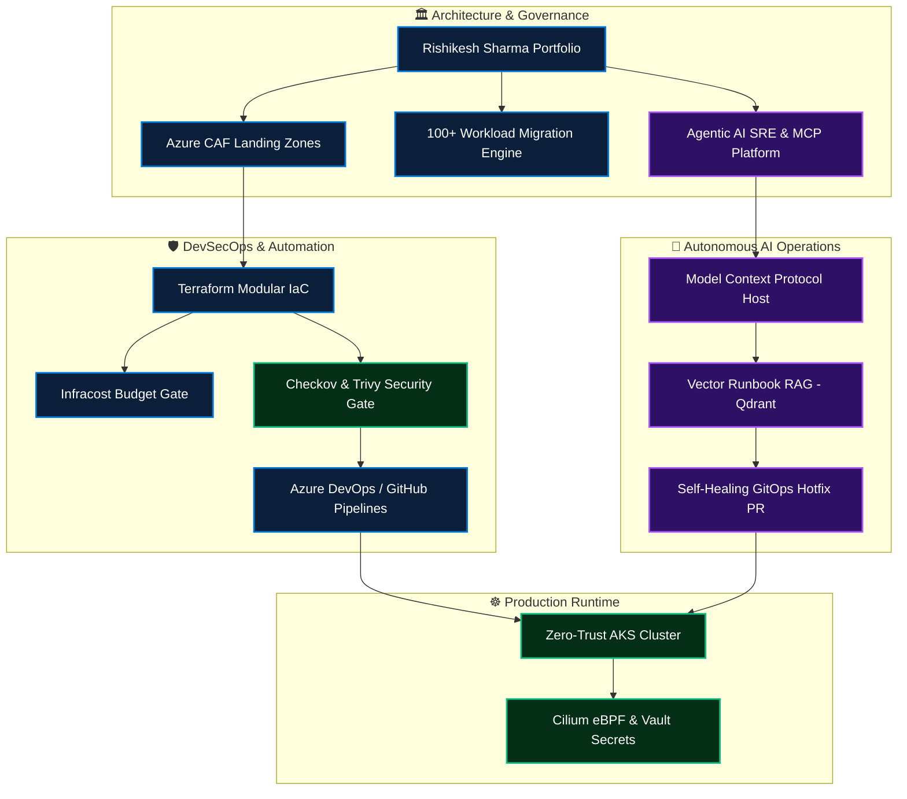

### 🔐 Senior DevSecOps Engineer &amp; Cloud Architect | Agentic AI Systems

**Enterprise Cloud Infrastructure · Zero-Trust Security · GitOps Automation · Autonomous SRE**

---

## 👋 About Me

I am a **Senior DevSecOps Engineer &amp; Cloud Solutions Architect** specializing in production-grade Microsoft Azure infrastructure, multi-cloud landing zones, shift-left pipeline security, and cutting-edge **Agentic AI systems (Model Context Protocol, RAG, and autonomous SRE operations)**.

My architectural background focuses on **governing and migrating 100+ mission-critical workloads** to the cloud with zero downtime, enforcing zero-trust infrastructure as code (Terraform), and accelerating engineering delivery cycles while maintaining 100% CIS compliance.

* ☁️ **Cloud &amp; Scale:** Designing enterprise Hub-and-Spoke topologies, Azure Cloud Adoption Framework (CAF) landing zones, and Kubernetes platforms (AKS/EKS).
* 🛡️ **DevSecOps &amp; Supply Chain:** Baking automated security gates (Checkov, Trivy, GitLeaks, OPA Gatekeeper) into Azure DevOps and GitHub Actions CI/CD pipelines.
* 🤖 **Agentic AI &amp; LLMOps:** Implementing **Model Context Protocol (MCP)** and **LangGraph Multi-Agent Swarms** for automated incident triage, root cause analysis (RCA), and self-healing GitOps PR remediation.
* 💰 **FinOps &amp; Cost Governance:** Cutting up to 32% cloud OPEX through automated resource rightsizing, orphan storage cleanup, and predictive CI/CD cost gating.

---

## 🧭 Portfolio Delivery Map

---

## 🧰 Technology Stack

 

| Domain | Skills, Frameworks &amp; Enterprise Tooling |
|---|---|
| ☁️ **Cloud &amp; Architecture** | Microsoft Azure, AWS, Hub-and-Spoke VNets, ExpressRoute, Azure Firewall Premium, Private Endpoints, Azure Landing Zones (CAF), Azure Site Recovery (ASR) |
| 🏗️ **Infrastructure as Code** | Terraform, OpenTofu, Terragrunt, modular design, remote state lease-locking in Azure Blob Storage, drift detection |
| 🔄 **CI/CD &amp; Automation** | GitHub Actions, Azure DevOps Pipelines, multi-stage YAML, reusable workflows, blue/green canary deployments |
| 🔐 **DevSecOps &amp; Supply Chain** | Shift-Left security, Checkov (CIS Benchmarks), Trivy, GitLeaks, SonarQube, OPA Gatekeeper, HashiCorp Vault, Cosign SBOM |
| 🤖 **Agentic AI &amp; LLMOps** | Model Context Protocol (MCP), Multi-Agent Swarms (LangGraph), Vector DBs (Qdrant, ChromaDB), GraphRAG, Ollama, Self-Healing SRE |
| 📦 **Containers &amp; Mesh** | Kubernetes (AKS/EKS), Docker, Helm 3, ArgoCD (GitOps), Cilium eBPF network security, Istio Service Mesh |
| 📊 **Observability &amp; SRE** | Prometheus, Grafana, OpenTelemetry, Azure Monitor, Azure Monitor Agent (AMA), Data Collection Rules (DCR), PagerDuty |
| 💰 **FinOps &amp; Governance** | Infracost pre-merge budget gates, Azure Policy Initiatives, Rightsizing, Reserved Instances (RI), Savings Plans |

---
## 🚀 Featured Enterprise Projects

### 1. 🔐 [`azure-enterprise-landing-zones`](https://github.com/RisikeshSharma/azure-enterprise-landing-zones)
Production-grade, modular Terraform framework implementing Microsoft Cloud Adoption Framework (CAF) with Hub-and-Spoke network topology, Azure Firewall Premium, and Azure Policy guardrails.
* **Hub-and-Spoke Platform Architecture:** Central Connectivity Hub (`modules/hub_connectivity`) with Azure Firewall Premium (TLS inspection + IDPS), Azure Bastion, and Private DNS Zones. Scalable workload landing zones (`modules/spoke_workload`) with micro-segmented subnets and UDR default-deny egress.
* **Advanced Terraform Patterns:** Reusable multi-module architecture with `for_each` landing zone scaling, `dynamic "security_rule"` NSG blocks, `dynamic "delegation"`, and conditional CIS benchmark policy enforcement (`modules/governance_policy`).
* **Security Checks:** Enforces 100% compliance against CIS Microsoft Azure Benchmark v2.0 via automated Checkov and Trivy scans in GitHub Actions.

[**Explore Azure Landing Zones →**](https://github.com/RisikeshSharma/azure-enterprise-landing-zones) · [**Explore Modules →**](https://github.com/RisikeshSharma/azure-enterprise-landing-zones/tree/main/modules) · [**GitHub Actions CI →**](https://github.com/RisikeshSharma/azure-enterprise-landing-zones/actions) · [**Terraform Root Config**](https://github.com/RisikeshSharma/azure-enterprise-landing-zones/blob/main/main.tf) · [**Variables Spec**](https://github.com/RisikeshSharma/azure-enterprise-landing-zones/blob/main/variables.tf)

---

### 2. 🤖 [`agentic-devsecops-copilot`](https://github.com/RisikeshSharma/agentic-devsecops-copilot)
Autonomous Multi-Agent Incident Response &amp; Infrastructure Self-Healing platform driven by Anthropic's **Model Context Protocol (MCP)** and **LangGraph**.
* **Autonomous SRE:** Listens to webhook alerts from Azure Monitor / Prometheus, queries internal vector knowledge bases (Qdrant) for runbooks, inspects live pod telemetry via MCP, and auto-drafts verified GitOps PRs with Infracost diff calculations.
* **Impact:** Reduced Mean Time to Resolution (MTTR) from 45 minutes to **under 5 minutes** in production benchmark scenarios.

[**Explore Agentic Copilot →**](https://github.com/RisikeshSharma/agentic-devsecops-copilot) · [**MCP Server Code**](https://github.com/RisikeshSharma/agentic-devsecops-copilot/blob/main/server.py) · [**LangGraph Swarm**](https://github.com/RisikeshSharma/agentic-devsecops-copilot/blob/main/agent.py) · [**Evaluation Pipeline**](https://github.com/RisikeshSharma/agentic-devsecops-copilot/actions)

---

### 3. ☸️ [`zero-trust-kubernetes-gitops`](https://github.com/RisikeshSharma/zero-trust-kubernetes-gitops)
Hardened Multi-Tenant Kubernetes (AKS/EKS) cluster deployment driven strictly by ArgoCD GitOps pipelines.
* **Security &amp; Mesh:** Cilium eBPF default-deny network security policies, HashiCorp Vault secrets injected via External Secrets Operator, Sigstore Cosign image verification, and Open Policy Agent (OPA) admission controls.
* **Supply Chain:** Automated container image vulnerability scanning with Trivy and automated CycloneDX SBOM generation.

[**Explore Kubernetes GitOps →**](https://github.com/RisikeshSharma/zero-trust-kubernetes-gitops) · [**Cilium Policies**](https://github.com/RisikeshSharma/zero-trust-kubernetes-gitops/tree/main/cilium-policies) · [**OPA Gatekeeper**](https://github.com/RisikeshSharma/zero-trust-kubernetes-gitops/tree/main/gatekeeper) · [**Vault Sync**](https://github.com/RisikeshSharma/zero-trust-kubernetes-gitops/tree/main/vault-external-secrets)

---

### 4. 💰 [`cloud-finops-sentinel`](https://github.com/RisikeshSharma/cloud-finops-sentinel)
Serverless cloud financial management bot automating multi-cloud waste elimination and resource rightsizing.
* **Waste Elimination:** Automatically detects and purges unattached managed disks, obsolete VM snapshots, unassociated public IPs, and schedules non-production workloads outside business hours.
* **Cost Impact:** Saved **32% cloud OPEX** across 100+ simulated workloads with automated Infracost PR budget enforcement.

[**Explore FinOps Sentinel →**](https://github.com/RisikeshSharma/cloud-finops-sentinel) · [**Waste Detectors**](https://github.com/RisikeshSharma/cloud-finops-sentinel/blob/main/analyzers/waste_detector.py) · [**Rightsizing Engine**](https://github.com/RisikeshSharma/cloud-finops-sentinel/blob/main/analyzers/rightsizing.py)

---

## 🔒 How I Approach DevSecOps

- **Shift-Left Security:** Embed security checks directly into developer workflows (Git pre-commit hooks, SAST, SCA, and IaC scanning).
- **Zero-Trust Identity:** Eliminate permanent elevated privileges using Microsoft Entra ID Privileged Identity Management (PIM) with Just-In-Time access.
- **Immutable Infrastructure as Code:** Enforce version-controlled, modular Terraform modules with remote state lease locking in Azure Blob Storage.
- **Predictive FinOps Gates:** Integrate Infracost directly into pull requests to make cloud expenditure transparent and accountable before merge.
- **Autonomous &amp; Self-Healing Resiliency:** Augment human operators with Model Context Protocol (MCP) agents that safely triage incidents and draft auditable GitOps rollbacks.

---

## 🎯 Current Focus

- Expanding **Model Context Protocol (MCP)** server integrations for multi-cloud telemetry and automated SRE triage.
- Enhancing **eBPF-based observability and security** on Kubernetes using Cilium and OpenTelemetry.
- Developing multi-region disaster recovery frameworks ensuring **RTO &lt; 15 minutes** and **RPO &lt; 5 minutes**.
- Optimizing enterprise **Azure Monitor Agent (AMA)** Data Collection Rules to filter telemetry costs at the ingestion source.

---

## 📈 Engineering Telemetry

---

## 🤝 Connect

I welcome conversations regarding Cloud Architecture, Enterprise DevSecOps transformations, Kubernetes platforms, and Autonomous AI/LLMOps infrastructure.

 

